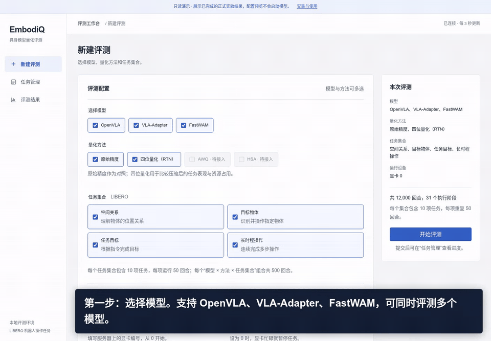
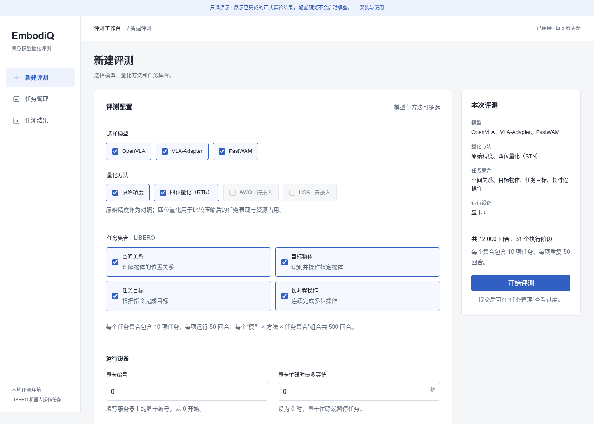
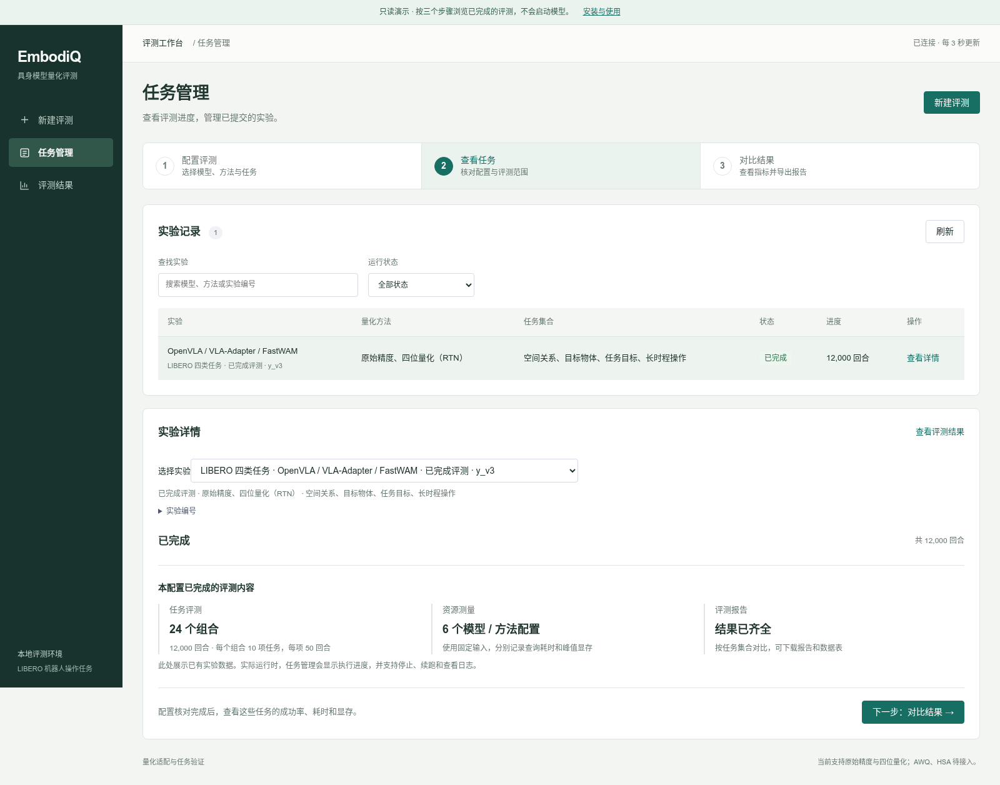
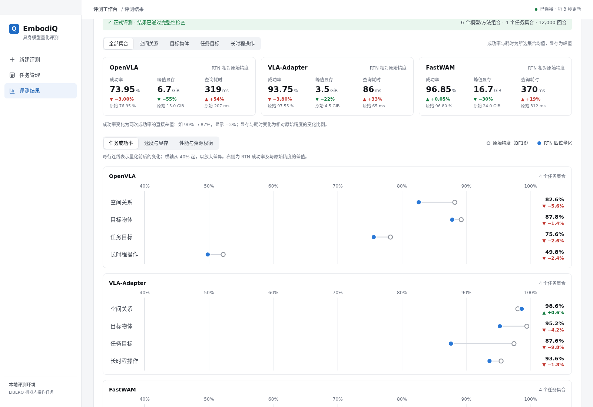

<h1 align="center">EmbodiQ</h1>
<p align="center"><strong>具身模型量化与任务评测工作台</strong></p>
<p align="center">选择模型与量化方法，统一评测机器人任务成功率、查询耗时和显存占用。</p>

<div align="center">


<a href="https://github.com/Kismeu/embodiq/actions/workflows/ci.yml"></a>
<a href="#授权与上游项目"></a>
</div>

<p align="center">
<a href="#演示">观看演示</a> · <a href="#支持范围">支持范围</a> · <a href="#开始使用">开始使用</a> · <a href="docs/getting_started.md">安装配置</a> · <a href="docs/web_workbench.md">工作台与 API</a>
</p>

## 演示

[](docs/media/embodiq-demo.mp4)

<p align="center"><a href="docs/media/embodiq-demo.mp4"><strong>观看完整视频 · 65 秒</strong></a> &nbsp; / &nbsp; <a href="#无需显卡体验界面">运行交互演示</a></p>

从模型配置到结果对比，整个流程使用同一个中文界面：

| 配置实验 | 管理任务 | 对比结果 |
| :--- | :--- | :--- |
| 选择模型、量化方法与任务集合，预览评测规模 | 查看执行进度与日志，停止任务或断点续跑 | 对照成功率、查询耗时与显存占用，导出报告 |

> 演示使用已完成且通过结果校验的**快速检查记录**，用于展示操作流程，不代表正式任务成功率。只读演示不会启动模型或占用显卡。

<details>
<summary>查看界面截图</summary>

**实验配置**



**任务管理**



**结果对比**



</details>

## 支持范围

| 模型 | 原始精度 | RTN 四位量化 | AWQ | HSA |
| :--- | :---: | :---: | :---: | :---: |
| [OpenVLA](https://github.com/openvla/openvla) | 已支持 | 已支持 | 待接入 | 待接入 |
| [VLA-Adapter](https://github.com/OpenHelix-Team/VLA-Adapter) | 已支持 | 已支持 | 待接入 | 待接入 |
| [FastWAM](https://github.com/yuantianyuan01/FastWAM) | 已支持 | 已支持 | 待接入 | 待接入 |

原始精度实际使用 **BF16**，配置名称沿用 `fp16`；RTN 使用 **4 位权重、每组 128 个权重**。FastWAM 的自动对比固定使用首帧模式（`first-frame`）。AWQ、HSA 的预留接口不表示已完成适配或验证，平台不会为它们生成占位分数。

评测覆盖 LIBERO 的四类任务：**空间关系、目标物体、任务目标、长时程操作**。模型、量化方法与任务集合可以组合选择，由平台依次完成预检、任务执行、资源测量和报告生成。

| 能力 | 当前实现 |
| :--- | :--- |
| 统一入口 | 中文网页、API、命令行共用评测流程 |
| 运行管理 | GPU 独占检查、阶段进度、日志、停止与断点续跑 |
| 结果指标 | 任务成功率、集合平均成功率、查询耗时、运行与加载峰值显存 |
| 结果导出 | JSON、Markdown、CSV、对比图 |
| 复现检查 | 记录并校验模型、代码、环境、输入及已完成结果 |

### 模型&环境下载
目前支持模型如下：[OpenVLA](https://github.com/openvla/openvla) · [VLA-Adapter](https://github.com/OpenHelix-Team/VLA-Adapter) · [FastWAM](https://github.com/yuantianyuan01/FastWAM)
目前支持的虚拟环境如下：[LIBERO](https://github.com/Lifelong-Robot-Learning/LIBERO)。


## 开始使用

### 无需显卡，体验界面

下载仓库，在根目录运行：

```bash
python -m http.server 8000 --bind 127.0.0.1
```

打开 **http://127.0.0.1:8000/demo/**，即可配置预览、浏览历史实验、切换任务集合并下载演示数据表。也可以直接在浏览器打开 `demo/index.html`。

GitHub 中的 HTML 文件链接显示源码；交互演示需下载后在本地打开。完整录屏见[演示视频](docs/media/embodiq-demo.mp4)。


### 启动评测工作台

建议使用 Linux、Python 3.10+，在仓库根目录执行：

```bash
python -m pip install -e '.[ctl]'
embodiq web --config configs/stage_fp16_rtn.json --runs-root results/platform --port 8765
```

打开 **http://127.0.0.1:8765**。页面可先浏览和预览配置；执行真实模型前，需要按[安装与配置](docs/getting_started.md)准备各模型独立环境、兼容权重、LIBERO 和固定评测输入。

### 运行一次快速检查

环境就绪后，可以在网页创建任务，也可以使用命令行：

```bash
embodiq launch configs/stage_fp16_rtn.json \
  --models vla_adapter --methods fp16 rtn \
  --suites libero_spatial --profile formal --gpu 0
```

完整的 **3 个模型 × 2 种方法 × 4 个集合**共计 **31 个阶段、12,000 回合**。更多用法见[命令行流程](docs/automatic_evaluation.md)。

## 如何理解评测结果

- **成功率**：按固定任务协议统计；完成全部四个集合的正式评测后，才给出四集合平均成功率。
- **查询耗时**：一次模型调用所需时间，不等同于机器人的端到端动作时延。
- **峰值显存**：运行峰值来自显卡监测，加载峰值来自推理框架，两者分别报告。
- **断点续跑**：校验模型、代码、环境、输入和已完成结果；条件发生变化时，应新建实验。

已有本地正式实验覆盖原始精度与 RTN 的 24 个模型／方法／集合组合，共 12,000 回合。历史资源采样口径与实验记录见[项目进展](docs/README.md)；其中 `results/` 链接指向本地材料，未随仓库发布。

<details>
<summary>部署范围与迁移说明</summary>

当前平台面向本地研究环境，不包含多用户认证、跨集群调度或任意模型上传。仓库不包含模型权重、训练数据及完整历史实验文件，也不会自动完成所有模型和仿真环境的安装。

`env/` 与部分历史工具保留实验机器上的默认路径。迁移时请按[安装与配置](docs/getting_started.md)检查路径、权重与输入清单。

</details>

## 开发与文档

| 路径 | 内容 |
| :--- | :--- |
| [`src/embodiq/`](src/embodiq/) | 统一接口、模型适配、量化、调度与 Web/API |
| [`configs/`](configs/) | 实验配置与待接入方法模板 |
| [`tests/`](tests/) | 协议、量化、结果准入与控制器测试 |
| [`tools/`](tools/) | 数据准备、资源测量、报告与演示工具 |
| [`env/`](env/) | 环境安装、兼容性与启动脚本 |
| [`demo/`](demo/) | 可离线运行的只读交互演示 |
| [`docs/`](docs/) | 使用说明、设计记录与演示素材 |

修改评测协议或模型适配后，请附上对应测试与复现步骤；新增量化方法需明确校准输入、量化范围和任务验证结果。

<details>
<summary>测试命令与已有验证记录</summary>

```bash
# 需安装量化及各测试所需依赖
CUDA_VISIBLE_DEVICES='' PYTHONPATH=src python -m pytest -q tests/
```

发布前的本机完整回归为 227 通过、23 跳过；中文界面调整后的 Web/API 专项为 19 通过。仓库另设 CPU 协议检查工作流，覆盖配置、任务协议和报告准入。跳过项与 CPU 检查均不能替代模型的 GPU 路径验证。

</details>


