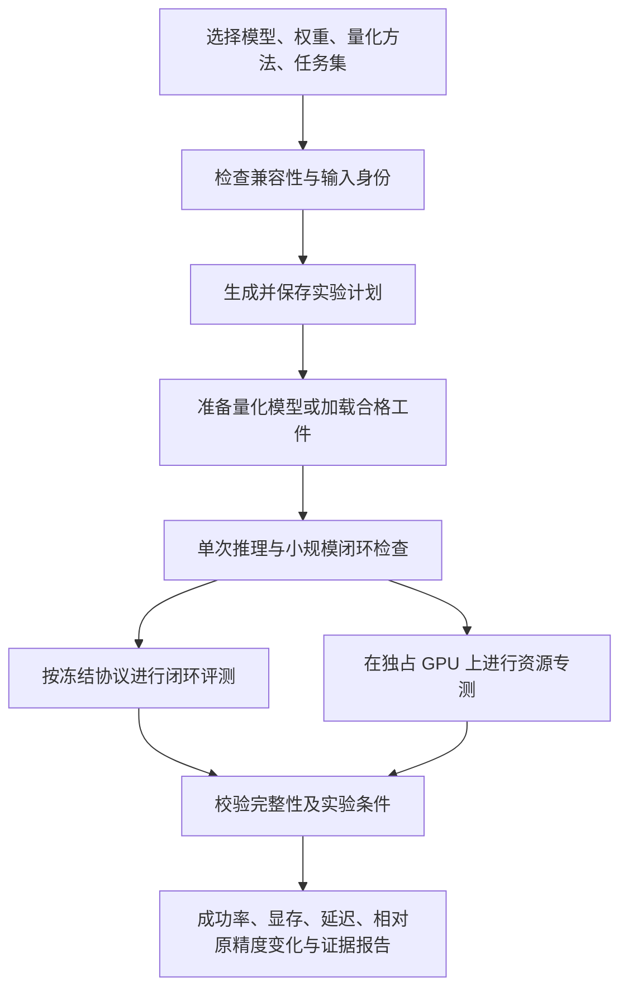

# embodiq 平台化：RLark / RoboColiseum 调研与落地建议

> 后续实现更新：阶段 A 的[本机 CLI 自动流程](automatic_evaluation.md)与阶段 B 的[本地 Web/API 工作台](web_workbench.md)已实现。下文保留调研时的代码核查与设计，不能作为当前功能缺口清单；跨集群及新 benchmark 仍是后续规划。

调研日期：2026-10-09。结论：可以沿现有框架做成“选择模型、量化方法与任务集，自动评测并生成对比报告”的平台，且与任务 1.4 一致。当前完成的是评测底座和原精度/RTN 实验；完整的一次提交自动执行平台尚未实现。本文件为官方资料及代码核查后的设计建议，不是已上线功能清单。

## 1. 两个参考项目解决什么问题

| 项目 | 已核实的定位 | 对 embodiq 的价值 |
|---|---|---|
| RLark | 跨集群任务与资源管理；声明式 Job/Task、Workflow 依赖、日志和 Web 管理 | 借鉴任务状态、依赖编排、资源分配；未来作为执行后端 |
| RoboColiseum / Genie Sim Benchmark | 标准化仿真任务、模型推理服务接入、批量运行和榜单 | 借鉴模型与仿真解耦、接入探测、分项报告；未来扩展 benchmark |
| embodiq | 对同一模型进行原精度及量化条件下的闭环与资源对比 | 核心是可追溯、协议一致的量化评测，复用现有三模型与 LIBERO 结果 |

RLark 官方仓库与文档提供上述任务和运维能力；Workflow 类型中有 `Dependencies`、阶段及起止时间。
当前官方路线图明确数据面支持 Kubernetes，Docker / Raw 属于规划；快速开始也标注尚无稳定版本。
因此可借鉴架构，但当前单机 Conda 运行环境不能直接假定已有 RLark Raw 后端。
来源：[仓库](https://github.com/RLinf/RLark)、[Workflow 类型](https://github.com/RLinf/RLark/blob/e2345f4acfec8f0f3aabdffe48283db39fb17014/api/rlark.io/v1alpha1/workflow_types.go)、[路线图](https://github.com/RLinf/RLark/blob/e2345f4acfec8f0f3aabdffe48283db39fb17014/ROADMAP.md)、[快速开始](https://rlark.readthedocs.io/zh-cn/latest/quickstart/)。

RoboColiseum 对应 AgibotTech 的 Genie Sim Benchmark；官方仓库提供四类榜单，支持本地推理服务先自测、再接线上评测。
Benchmark CLI 有接口探测、单任务及批量评测；公开接入协议使用 WebSocket 与 msgpack，区分预热及回合会话。
来源：[官方仓库](https://github.com/AgibotTech/genie_sim)、[Benchmark 文档](https://github.com/AgibotTech/genie_sim/blob/6ca11c7593ecf6b7dae58c28fd19f4a789a0dd46/source/geniesim_benchmark/README.md)、[隧道协议](https://github.com/AgibotTech/genie_sim/blob/6ca11c7593ecf6b7dae58c28fd19f4a789a0dd46/source/geniesim_benchmark/skills/robocoliseum/challenge-run-agent/SKILL.md)。这里只将上游文档作为调研材料，未执行其账号、提交或部署流程。

“5 分钟接入、10 秒启动”是报道中的平台运行指标，不等于权重下载、模型加载及完整评测总耗时，本次没有独立复测这些数字。
“89.5%”也不能转写为任意仿真任务对真机成功率的保证：本次检查到的官方 README 有 Sim2Real 对照表，但未找到足以独立复算该数值的完整样本、相关系数定义及统计过程。我们的 LIBERO 结果没有真机配对验证，不能引用此数字作为自己的结论。
官方对照表见[GenieSim-Sim2Real](https://github.com/AgibotTech/genie_sim#geniesim-sim2real)。

注意名称区别：这里的 RoboColiseum 是上述线上平台，不是 2024 年基于 RLBench/PyRep 的 THE COLOSSEUM。

## 2. 本地代码核查：已经具备与还缺少的能力

| 环节 | 现有能力 | 平台化缺口 |
|---|---|---|
| 模型接入 | 三模型 `Observation → Policy → ActionChunk`；FastWAM first-frame/IDM | 显式能力注册：机器人、相机、状态、动作语义、支持任务与模式；新增模型适配验收 |
| 量化 | 原精度/RTN 可运行；AWQ/HSA 工件加载、校验与方法身份 | producer 插件与兼容矩阵；AWQ/HSA 显示待接入，不允许提交正式测评 |
| 实验描述 | `config.py` 校验；`plan` 展开模型×方法×集合 | 当前要求三模型配置，缺少用户选择子集的稳定请求接口；部分字段还没有执行消费者 |
| 执行 | `run` 创建运行目录；`execute/resume` 执行一个 job，环境隔离与日志 | 整批调度、GPU 锁/租约、队列、依赖、并发状态更新与崩溃恢复 |
| 状态与停止 | JSON 状态、回合断点恢复 | `stop` 仅设置标志，不能终止子进程；需明确 running/stopping/failed/blocked，不能把 blocked 当成功 |
| 资源 | `run_resource_bench.py` 固定输入、预热、争用检查；报告已接六组历史专测 | 将资源测量加入运行依赖图；当前配置的 resource 块不会自动启动它，部分模型路径仍按既有脚本固定 |
| 报告 | 正式矩阵、准入、成功率/显存/查询耗时、对比图 | 当前报告偏固定任务 1.4 来源；`report --out` 改输出目录，不会自动绑定任意新 run 的所有证据 |
| 产品入口 | CLI 可用 | 创建任务页、队列和日志页、报告页及对应 API |

核查文件：`src/embodiq/{config,runner}.py`、`ctl/cli.py`、`entry/evaluate.py`、
`core/admission.py`、`tools/{run_resource_bench,report_matrix}.py`。

“支持输入模型”应首先表示支持已注册模型及兼容 checkpoint。任意新架构需要适配观测、动作、归一化统计与机器人控制语义；只提供权重路径不足以保证可测。
“支持量化方法”同样需要声明量化范围、校准要求、工件格式和运行后端，不能只增加下拉框名称。

## 3. 建议的用户流程

用户只需选择模型/权重、方法、任务集、评测档位和可用资源；其余由平台解析。



一次请求可以包含多种方法；选择 RTN 时可同时加入匹配原精度基线。
模型、checkpoint、量化范围、工件哈希、归一化统计、协议、种子、episode 清单及资源输入都应写入不可变运行描述。
基线只在这些条件及相关运行环境相容时复用，不能仅凭模型名取一条历史成绩。

第一版建议仅开放三种已适配模型、LIBERO 四集合、原精度和 RTN，保留 FastWAM first-frame 的正式可比条件。
IDM 放在独立验证档位；AWQ/HSA 显示“待接入”，无 producer/合格工件时拒绝执行，不生成零分。

## 4. 实现顺序与验收

### 阶段 A：先实现真正的一次提交执行

在现有 CLI 下增加模型/方法/benchmark 能力注册、运行请求解析、执行器和按运行汇总。
依赖链覆盖预检、量化、检查、闭环、资源、报告；本机先用独立 worker 进程与持久化状态库。
资源不足时排队；正式资源专测要求 GPU 独占；取消只作用于该运行的子进程。

验收：提交一次三模型中任一模型的原精度+RTN 请求后，无需手动逐 job 启动；
能从中断点恢复，完整记录失败原因；产出本次运行的 JSON/CSV/图表。
重复提交不会混写，缺失工件会在模型加载前阻塞，开发结果不能混入正式表。
先用 CPU 假执行器测试状态、依赖和恢复，再做真实 GPU 小规模闭环及资源专测，最后验证正式档位。

### 阶段 B：增加平台入口

围绕同一请求与执行器提供 API 和三个页面：创建实验、任务状态/日志、结果对比。
界面不重新实现模型或量化逻辑。报告必须展示任务成功率、各集合宏平均、加载与稳态显存、
查询耗时及动作步摊销耗时，并提供原始证据下载。

建议 API（设计草案，当前未实现）：

```text
GET  /api/capabilities       可用模型、方法、任务与兼容条件
POST /api/runs              保存请求并排队
GET  /api/runs/{id}         状态、进度、失败原因
GET  /api/runs/{id}/logs    日志
POST /api/runs/{id}/cancel  停止该运行
POST /api/runs/{id}/resume  恢复未完成阶段
GET  /api/runs/{id}/report  可追溯的结果
```

### 阶段 C：按需要扩展基础设施与 benchmark

有跨机器需求后，将同一执行接口增加 RLark 后端；容器中执行 embodiq job，输出到持久存储。
需固定 RLark 提交和镜像，不把其停止/重启语义等同于我们的 episode 续跑：官方文档说明 Workflow
恢复会从 DAG 起点新建运行，因此 embodiq 自己保留幂等性、证据与回合检查点。
来源：[RLark 生命周期](https://rlark.readthedocs.io/en/latest/concepts/)。

RoboColiseum 可作为独立 benchmark 后端评估，但必须先解决机器人与动作兼容性。
其 G2 示例为头部/双手相机、双臂绝对关节或末端位姿控制；我们的 LIBERO 权重为单臂操作条件，
动作维数和训练分布不同。网络桥接不会自动产生跨机器人能力，可能需要相应权重或重新训练。
来源：[实际推理客户端](https://github.com/AgibotTech/genie_sim/blob/6ca11c7593ecf6b7dae58c28fd19f4a789a0dd46/source/geniesim_benchmark/src/geniesim_benchmark/benchmark/policy/corobotpolicy.py)。

远程后端还要分别记录模型本地推理耗时、序列化/传输耗时和端到端响应耗时；
本地 GPU 显存由推理端采集，不能由远程服务延迟推断量化加速。
不同 benchmark 的评分分别展示，不能将分步骤得分与 LIBERO 二元成功率直接取平均。

## 5. 调研可复查性

本次只进行了公开资料与代码读取，没有部署 RLark、下载仿真资产或向 RoboColiseum 提交模型。
读取时的仓库提交：

- RLark：`e2345f4acfec8f0f3aabdffe48283db39fb17014`。
- Genie Sim：`6ca11c7593ecf6b7dae58c28fd19f4a789a0dd46`。

RLark 根目录为 Apache-2.0；Genie Sim Benchmark 文档标明 MPL-2.0，资产和其他组件应分别核对。
当前建议以独立后端接入，尚未复制这些项目代码到执行框架。
两者都不能直接提供我们缺失的 AWQ/HSA 算法与本项目数值验证结果。
